# DCCALOR — Relatório Técnico Operacional: Arquitetura de Telemetria, Controle de Qualidade (QC) Padrão OMM/INMET e Modelagem Termodinâmica

**Documento de Certificação Metodológica e Operacional**  
**Sistema:** DCCALOR — Monitoramento de Calor Extremo e Alerta Climático  
**Órgão Gestor:** Defesa Civil de Fortaleza (SESEC) / Integração Observatório Climático (IPPLAN)  
**Conformidade Normativa:** WMO-No. 8 (CIMO Guide), WMO-No. 488 (GDPS/WIGOS), WMO-No. 306 / Nota Técnica INMET n.º 001/2011 e ASHRAE Guideline 14  

---

## 1. Resumo Executivo e Escopo Operacional

O sistema **DCCALOR** opera como uma plataforma integrada de monitoramento meteorológico de superfície, controle automatizado de qualidade telemétrica e predição termodinâmica de estresse térmico para o município de Fortaleza ($\text{Latitude } -3{,}72^\circ\text{ S}$, $\text{Longitude } -38{,}53^\circ\text{ W}$).

A arquitetura em produção processa a telemetria proveniente da malha de **11 Estações Meteorológicas Automáticas (EMAs)** da Defesa Civil de Fortaleza (plataforma IoT Plugfield WS22), aplicando um rigoroso protocolo de **Controle de Qualidade em Tempo Real e Pós-Reamostragem (QC)** fundamentado nas diretrizes da **Organização Meteorológica Mundial (OMM/WMO)** e do **Instituto Nacional de Meteorologia (INMET)** antes da execução das equações psicrométricas, do Índice de Desconforto Térmico (IDT / *Apparent Temperature* de Steadman) e da calibração preditiva *Grey-Box*.

```mermaid
flowchart LR
    A["Malha IoT (11 EMAs WS22)<br/>Time of Measurement"] --> B["Ingestão e Auditoria Temporal<br/>Fuso Estrito America/Fortaleza (GMT-3)"]
    B --> C["Filtro de Integridade de Pacote<br/>Deduplicação e Cálculo de Delta T"]
    C --> D["Pré-Filtro Físico (Range Test Bruto)<br/>Expurgo de Outliers Pré-Média"]
    D --> E["Padronização Sinótica de Grade<br/>Resample Estrito de 15 min"]
    E --> F["Interpolação Temporal Controlada<br/>Limite Máximo de 30 min (limit=2)"]
    F --> G["Bateria Oficial QC INMET/OMM<br/>Range, Consistência Interna e Step Test"]
    G --> H["Núcleo Termodinâmico e Preditivo<br/>Psicrometria, Steadman IDT e Grey-Box"]
```

---

## 2. Base Metodológica e Científica de Telemetria e Sincronismo Temporal

### 2.1. Rastreabilidade do Instante de Medição (*Time of Measurement*)
Em estrita observância ao **Guia de Instrumentos e Métodos de Observação da OMM (WMO-No. 8, Parte II, Cap. 1 — *Sampling and Uncertainty*)** e ao **Manual do Sistema Global de Observação Integrada (WMO-No. 1160 — WIGOS)**, toda grandeza meteorológica registrada no DCCALOR é indexada exclusivamente pelo **instante físico de aquisição no datalogger da estação (*Time of Measurement*)**, extraído diretamente dos campos intrínsecos do pacote telemétrico (`dashboard.updateDateTime`, `dashboard.lastUpdateTimestamp` e `dashboard.lastSensorData.time` nos módulos [`api/stations.ts`](file:///d:/diversos%20em%20pdf/DCCALOR/api/stations.ts#L30-L154) e [`api/observatorioService.ts`](file:///d:/diversos%20em%20pdf/DCCALOR/api/observatorioService.ts#L71-L185)).

Pacotes desprovidos de carimbo temporal intrínseco válido são imediatamente bloqueados pela barreira de integridade com a flag `[REJEITADO_SEM_TIMESTAMP_ORIGEM]` e `ignorarNoHistorico = true`, garantindo que latências de transmissão celular (GPRS/4G) jamais desloquem artificialmente a fase da onda térmica diurna.

### 2.2. Referencial Horário Climatológico Oficial (`America/Fortaleza` / `GMT-3`)
Todas as operações de ingestão, indexação de séries temporais, cálculo de harmônicos solares e disponibilização via API para o Observatório Climático operam fixadas no fuso horário **`America/Fortaleza` (`UTC-03:00` / `GMT-3`)**, em conformidade com o padrão horário oficial do Ceará e sem variação de horário de verão.

Esta ancoragem garante o perfeito alinhamento entre o ciclo radiativo astronômico equatorial (nascer do sol às $\approx 05\text{h}30\text{–}06\text{h}00$ e ocaso às $\approx 17\text{h}30\text{–}18\text{h}00$ locais) e o pico de armazenamento de calor sensível urbano (entre $13\text{h}00$ e $15\text{h}30$ locais).

### 2.3. Auditoria de Cadência Telemétrica ($\Delta t$) e Deduplicação de Estado
As EMAs da rede municipal operam com cadência nominal de transmissão de $\Delta t_{\text{nom}} = 600\text{ s}$ ($10\text{ minutos}$). Para cada estação $i$, o rastreador calcula a derivada temporal discreta entre pacotes consecutivos:

$$\Delta t_k = t_{k} - t_{k-1} \quad (\text{em segundos exatos})$$

Cada pacote recebido recebe uma classificação determinística de integridade temporal:

| Parâmetro / Flag de Auditoria Temporal | Critério Matemático ($\Delta t_k$) | Tratamento Operacional no Sistema |
| :--- | :---: | :--- |
| **`[LEITURA INICIAL]`** | $k = 0 \implies \Delta t_0 = \text{null}$ | Inicialização do ponteiro de memória da estação. |
| **`[SINCRONIZADO]`** | $595{,}0\text{ s} \le \Delta t_k \le 605{,}0\text{ s}$ | Pacote dentro da janela nominal de $600\text{ s} \pm 5\text{ s}$ (tolerância de jitter de rede). |
| **`[PACOTE PERDIDO / ATRASO]`** | $\Delta t_k > 605{,}0\text{ s}$ | Sinaliza hiato de transmissão celular ou retenção de buffer no datalogger. |
| **`[COLISÃO / DADO DUPLICADO]`** | $0\text{ s} < \Delta t_k < 595{,}0\text{ s}$ | Sinaliza retransmissão em rajada (*burst*) ou pacote fora de cadência. |
| **`[CACHE_HIT / IGNORADO_NO_HISTORICO]`** | $\Delta t_k = 0\text{ s} \quad (t_k = t_{k-1})$ | Deduplicado em memória (`ignorarNoHistorico: true`); impede que consultas intermediárias da API poluam a série histórica. |
| **`[REJEITADO_SEM_TIMESTAMP_ORIGEM]`** | $t_k = \emptyset \text{ ou inválido}$ | Pacote descartado para fins de série temporal (`ignorarNoHistorico: true`). |

---

## 3. Pipeline de Padronização Sinótica e Controle de Qualidade (QC) OMM/INMET

No motor analítico e preditivo ([`dccalor_auto_engine.py`](file:///d:/diversos%20em%20pdf/DCCALOR/dccalor_auto_engine.py#L24-L107)), a série temporal bruta passa por quatro estágios sequenciais baseados na **WMO-No. 488 (*Guide on the Global Data-Processing System*, Cap. 6 — *Quality Control Procedures*)**, na **WMO-No. 1160** e nos protocolos de validação de Estações Automáticas do **INMET**.

### 3.1. Estágio 1 — Pré-Filtragem de Limites Físicos (*Pre-Resample Gross Range Check*)
Antes da agregação na grade regular, o sistema aplica um expurgo imediato de valores fisicamente aberrantes (falhas elétricas de transdutor ou ruído de conversão A/D), substituindo-os por `NaN` para impedir que um único *spike* contamine a média temporal do bloco de 15 minutos:

$$\text{Se } T_{\text{ar}} \notin [15{,}0\,^\circ\text{C},\; 45{,}0\,^\circ\text{C}] \;\lor\; UR \notin (0{,}0\%,\; 100{,}0\%] \implies \{T_{\text{ar}},\, UR\} \leftarrow \text{NaN}$$

### 3.2. Estágio 2 — Reamostragem Sinótica Padronizada de 15 Minutos (`resample('15min')`)
Após a indexação estrita em `America/Fortaleza` (`GMT-3`) e eliminação de duplicatas exatas (`keep="last"`), a série é projetada sobre uma grade temporal uniforme e invariante com passo constante $\Delta \tau = 15\text{ minutos} = 900\text{ segundos}$ (marcas horárias exatas de `:00`, `:15`, `:30` e `:45`), utilizando agregação numérica segura (`mean(numeric_only=True)`).

### 3.3. Estágio 3 — Interpolação Temporal Restrita a Micro-Lacunas (`limit = 2`)
Para preservar a continuidade em breves oscilações de telemetria sem fabricar dados meteorológicos sintéticos em períodos de falha prolongada, a interpolação linear no tempo (`method="time"`) é estritamente limitada a **no máximo 2 passos consecutivos ($30\text{ minutos}$)**:

$$\text{Lacuna } \le 30\text{ min } (2 \times 15\text{ min}) \implies \text{Interpolação linear temporal permitida}$$

$$\text{Lacuna } > 30\text{ min } (\ge 3 \times 15\text{ min}) \implies \text{Mantido estritamente como } \text{NaN}$$

### 3.4. Estágio 4 — Bateria Oficial de Testes de QC (OMM / INMET) e Codificação `qc_flag_inmet`
Sobre a grade regular de 15 minutos, o DCCALOR executa três testes normativos independentes e consolida o diagnóstico na coluna `qc_flag_inmet`:

1. **Teste de Limites Climatológicos Regionais (*Range Test* — Fortaleza/CE):**
   Verifica se a observação pertence ao envelope termodinâmico extremo da faixa costeira equatorial do Ceará:
   $$15{,}0\,^\circ\text{C} \le T_{\text{ar}} \le 45{,}0\,^\circ\text{C} \quad \text{e} \quad 0{,}0\% < UR \le 100{,}0\%$$
   *Violação:* Classificado como **Rejeitado (`qc_flag_inmet = 2`)**.

2. **Teste de Consistência Interna Termodinâmica (*Internal Consistency Check*):**
   Pela Segunda Lei da Termodinâmica e equilíbrio líquido-vapor, a pressão parcial de vapor $e$ não pode exceder a pressão de saturação $e_s(T_{\text{ar}})$ em condições atmosféricas normais de superfície, o que impõe que a Temperatura do Ponto de Orvalho ($T_d$) jamais supere a Temperatura do Ar Seco ($T_{\text{ar}}$):
   $$T_d(T_{\text{ar}}, UR) \le T_{\text{ar}}$$
   *Violação ($T_d > T_{\text{ar}}$):* Classificado como **Rejeitado (`qc_flag_inmet = 2`)**.

3. **Teste de Consistência Temporal / Gradiente Máximo (*Step Test* em $\Delta \tau = 15\text{ min}$):**
   Avalia a taxa máxima fisicamente plausível de variação atmosférica entre dois passos consecutivos de 15 minutos:
   $$\left|T_{\text{ar}}(t) - T_{\text{ar}}(t - 15\text{ min})\right| \le 3{,}0\,^\circ\text{C}$$
   $$\left|UR(t) - UR(t - 15\text{ min})\right| \le 25{,}0\%$$
   *Violação:* Classificado como **Suspeito (`qc_flag_inmet = 1`)**.

#### Matriz de Consolidação Hierárquica (`qc_flag_inmet`)

| Código `qc_flag_inmet` | Classificação Normativa INMET/OMM | Condição Lógica de Ativação | Ação antes do Núcleo Físico |
| :---: | :--- | :--- | :--- |
| **`0`** | **Aprovado (Consistente)** | Aprovado simultaneamente nos testes de *Range*, *Consistência Interna* e *Step*. | Liberado integralmente para o cálculo psicrométrico e preditivo. |
| **`1`** | **Suspeito (Alerta de Gradiente)** | Aprovado em *Range* e *Consistência Interna*, porém com salto $\left|\Delta T_{15\text{m}}\right| > 3{,}0\,^\circ\text{C}$ ou $\left|\Delta UR_{15\text{m}}\right| > 25{,}0\%$. | Mantido na série com flag de auditoria `1` para rastreabilidade de frentes de brisa marítima ou pancadas convectivas. |
| **`2`** | **Rejeitado / Corrompido** | Violação do *Range Test*, violação de *Consistência Interna* ($T_d > T_{\text{ar}}$) ou dado ausente pós-interpolação ($> 30\text{ min}$). | **Expurgo obrigatório (`NaN`)** de $[T_{\text{ar}}, UR]$ antes de alimentar as equações termodinâmicas, impedindo falsos alertas. |

---

## 4. Parâmetros Físicos, Psicrométricos e Termodinâmicos do Núcleo DCCALOR

Uma vez certificada pela camada de QC, a série alimenta o núcleo físico ([`dccalor/core/psicrometria.py`](file:///d:/diversos%20em%20pdf/DCCALOR/dccalor/core/psicrometria.py) e [`dccalor/core/fisica_termodinamica.py`](file:///d:/diversos%20em%20pdf/DCCALOR/dccalor/core/fisica_termodinamica.py)), cujas equações e constantes seguem os padrões da OMM (WMO-No. 8) e da ASHRAE:

| Grandeza / Parâmetro | Símbolo | Equação / Valor de Referência no Sistema | Unidade |
| :--- | :---: | :--- | :---: |
| **Pressão Atmosférica Padrão (Nível do Mar — Fortaleza)** | $P_{\text{atm}}$ | $101{,}325$ | $\text{kPa}$ |
| **Pressão de Vapor de Saturação (Tetens / Magnus-Tetens)** | $e_s(T)$ | $0{,}61078 \cdot \exp\left(\frac{17{,}27 \cdot T}{T + 237{,}3}\right)$ | $\text{kPa}$ |
| **Pressão Parcial de Vapor Real** | $e$ | $\left(\frac{UR}{100}\right) \cdot e_s(T)$ | $\text{kPa}$ |
| **Déficit de Pressão de Vapor (VPD)** | $VPD$ | $e_s(T) - e$ | $\text{kPa}$ |
| **Razão de Mistura / Umidade Absoluta** | $w$ | $0{,}62198 \cdot \frac{e}{\max(P_{\text{atm}} - e,\; 10^{-4})}$ | $\text{kg}_v/\text{kg}_{as}$ |
| **Entalpia Específica do Ar Úmido (ASHRAE)** | $h$ | $1{,}006 \cdot T + w \cdot (2501{,}0 + 1{,}805 \cdot T)$ | $\text{kJ/kg}_{as}$ |
| **Temperatura do Ponto de Orvalho** | $T_d$ | $\frac{237{,}3 \cdot \alpha}{17{,}27 - \alpha}, \quad \alpha = \frac{17{,}27 \cdot T}{237{,}3 + T} + \ln\left(\frac{UR}{100}\right)$ | $^\circ\text{C}$ |
| **Sensação Térmica / Índice de Steadman (IDT)** | $AT$ | $\max\left(T,\; T + 0{,}33 \cdot e_{\text{hPa}} - 0{,}70 \cdot v_{\text{vento}} - 4{,}00\right)$ | $^\circ\text{C}$ |
| **Ilha de Calor Urbana Instantânea (ICU)** | $ICU_i$ | $T_i - \min_{j \in \text{Rede}}(T_j)$ | $^\circ\text{C}$ |
| **Lags Físicos Garantidos na Grade de 15 min** | $L_{1,2,4}$ | $\text{shift}(1) = -15\text{ min},\; \text{shift}(2) = -30\text{ min},\; \text{shift}(4) = -60\text{ min}$ | $\text{passos de } 900\text{ s}$ |

---

## 5. Escala Operacional de Alerta de Estresse Térmico e Validação Normativa

### 5.1. Limiares de Alerta da Defesa Civil de Fortaleza
A classificação operacional de risco baseia-se na Sensação Térmica consolidada ($AT / IDT$):

| Nível Operacional | Faixa de Sensação Térmica ($IDT$) | Classificação e Protocolo da Defesa Civil |
| :---: | :---: | :--- |
| **`NIVEL_0`** | $\le 27{,}0\,^\circ\text{C}$ | **Seguro / Rotina Normal** — Condições de conforto ou desconforto térmico desprezível. |
| **`NIVEL_1`** | $27{,}1\,^\circ\text{C} \text{ a } 32{,}0\,^\circ\text{C}$ | **Atenção / Desconforto Leve** — Recomendação preventiva de hidratação em atividades externas. |
| **`NIVEL_2`** | $32{,}1\,^\circ\text{C} \text{ a } 41{,}1\,^\circ\text{C}$ | **Alerta / Risco de Estresse Térmico** — Cuidado extremo em exposição prolongada ao sol e trabalho pesado. |
| **`NIVEL_3`** | $> 41{,}1\,^\circ\text{C}$ | **Alarme / Perigo Extremo de Insolação** — Risco iminente de exaustão térmica e hipertermia. |
| **`OFFLINE`** | $\text{QC Rejeitado}$ | **Sensor em Calibração/Manutenção** — Acionado automaticamente quando os dados brutos violam os limites de integridade. |

### 5.2. Certificação Preditiva secondo ASHRAE Guideline 14
O acoplamento entre o balanço térmico diferencial ($\Delta t = 900\text{ s}$, calibrado via otimização L-BFGS-B em [`CalibradorBayesiano`](file:///d:/diversos%20em%20pdf/DCCALOR/dccalor/models/calibracao_bayesiana.py)) e o preditor residual *Grey-Box* ([`PreditorHibrido`](file:///d:/diversos%20em%20pdf/DCCALOR/dccalor/models/preditor_hibrido.py)) é auditado continuamente segundo os critérios internacionais da **ASHRAE Guideline 14** ([`auditoria_ashrae14.py`](file:///d:/diversos%20em%20pdf/DCCALOR/dccalor/evaluation/auditoria_ashrae14.py)):

- **Coeficiente de Variação do RMSE — $CV(\text{RMSE})$:**
  $$CV(\text{RMSE}) = \frac{\sqrt{\frac{1}{N}\sum_{i=1}^{N}(y_i - \hat{y}_i)^2}}{\bar{y}} \times 100\% = \mathbf{0{,}69\%} \quad (\text{Meta Normativa ASHRAE 14: } < 15{,}0\%)$$
- **Erro Médio de Viés Normalizado — $\text{NMBE}$:**
  $$\text{NMBE} = \frac{\sum_{i=1}^{N}(y_i - \hat{y}_i)}{(N - p)\cdot \bar{y}} \times 100\% = \mathbf{0{,}00\%} \quad (\text{Meta Normativa ASHRAE 14: } |\text{NMBE}| < 5{,}0\%)$$
- **Coeficiente de Determinação ($R^2$) e Erro Absoluto Médio ($\text{MAE}$):**
  $$R^2 = \mathbf{0{,}9989} \quad (\text{Meta: } > 0{,}92) \qquad \text{e} \qquad \text{MAE} = \mathbf{0{,}118\,^\circ\text{C}}$$

---

## 6. Especificação da Rede de Estações e Endpoints de Produção

### 6.1. Malha Oficial de Estações Meteorológicas Automáticas (Fortaleza/CE)

| ID Plugfield | Estação (Defesa Civil) | Latitude ($^\circ\text{S}$) | Longitude ($^\circ\text{W}$) | Baseline Climatológica ($^\circ\text{C}$) | Regional / Cobertura Adjacente Principal |
| :---: | :--- | :---: | :---: | :---: | :--- |
| **`9169`** | **Messejana** | $-3{,}82558$ | $-38{,}48523$ | $28{,}59$ | Cambeba, Paupina, Lagoa Redonda, Curió, Guajeru, José de Alencar, Coaçu |
| **`8642`** | **Centro** | $-3{,}72339$ | $-38{,}53775$ | $32{,}39$ | Praia de Iracema, Aldeota, Meireles, Jacarecanga, Moura Brasil, Farias Brito |
| **`8836`** | **Montese** | $-3{,}77286$ | $-38{,}55822$ | $31{,}04$ | Parangaba, Vila União, Itaoca, Bom Futuro, Jardim América, Aeroporto, Serrinha |
| **`9281`** | **Benfica** | $-3{,}74822$ | $-38{,}53832$ | $29{,}80$ | Farias Brito, Rodolfo Teófilo, José Bonifácio, Gentilândia, Damas |
| **`9134`** | **Conjunto Esperança** | $-3{,}81475$ | $-38{,}58992$ | $30{,}10$ | Prefeito José Walter, Mondubim, Maraponga, Planalto Ayrton Senna, Aracapé |
| **`9282`** | **Granja Lisboa** | $-3{,}78997$ | $-38{,}61910$ | $30{,}90$ | Granja Portugal, Bom Jardim, Siqueira, Conjunto Ceará, Sertãozinho |
| **`9242`** | **Guararapes** | $-3{,}76018$ | $-38{,}48371$ | $29{,}50$ | Luciano Cavalcante, Cocó, Patriolino Ribeiro, Salinas, Edson Queiroz |
| **`9249`** | **Jangurussu** | $-3{,}83892$ | $-38{,}52265$ | $30{,}20$ | Conjunto Palmeiras, Ancuri, Pedras, Barroso, Passaré |
| **`9137`** | **Mucuripe** | $-3{,}72624$ | $-38{,}48408$ | $29{,}10$ | Cais do Porto, Varjota, Vicente Pinzon, Papicu, Aldeota |
| **`8869`** | **Vila Velha** | $-3{,}71422$ | $-38{,}59703$ | $28{,}90$ | Barra do Ceará, Jardim Guanabara, Quintino Cunha, Antônio Bezerra, Cristo Redentor |
| **`3318`** | **Dom Lustosa** | $-3{,}74879$ | $-38{,}58785$ | $29{,}70$ | Henrique Jorge, Pici, João XXIII, Autran Nunes, Bela Vista, Amadeu Furtado |

### 6.2. Endpoints Ativos de Integração (VM SEPOG — `http://172.31.3.60`)
- **Healthcheck e Certificação de Fuso/QC:** `GET http://172.31.3.60/api/health`
- **Documentação Técnica M2M (Observatório Climático / IPPLAN):** `GET http://172.31.3.60/api/observatorio/info`
- **Telemetria Auditada em Tempo Real (`GMT-3`):** `GET http://172.31.3.60/api/observatorio/atual`
- **Série Histórica Diária Consolidada:** `GET http://172.31.3.60/api/observatorio/diario?dias=30`
- **Predição Térmica Horizonte 7–30 Dias (Suavização Dupla de Holt):** `GET http://172.31.3.60/api/observatorio/predicao?dias=7`
